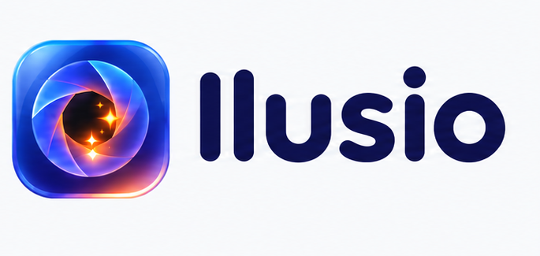
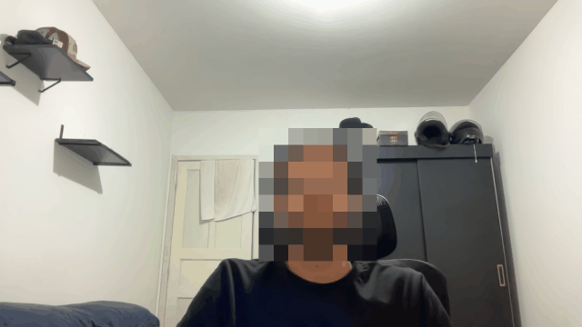
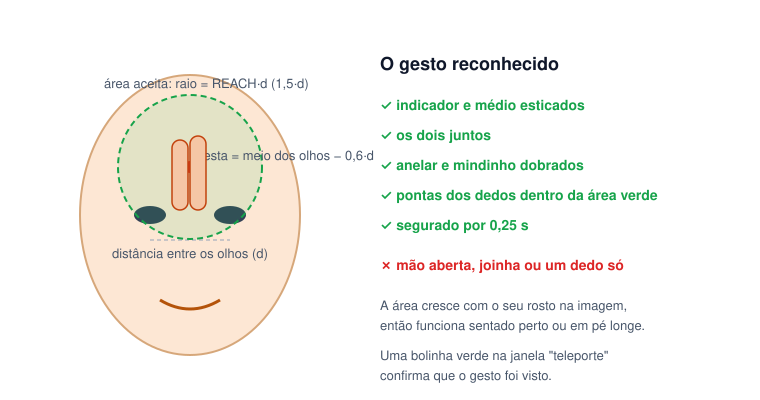
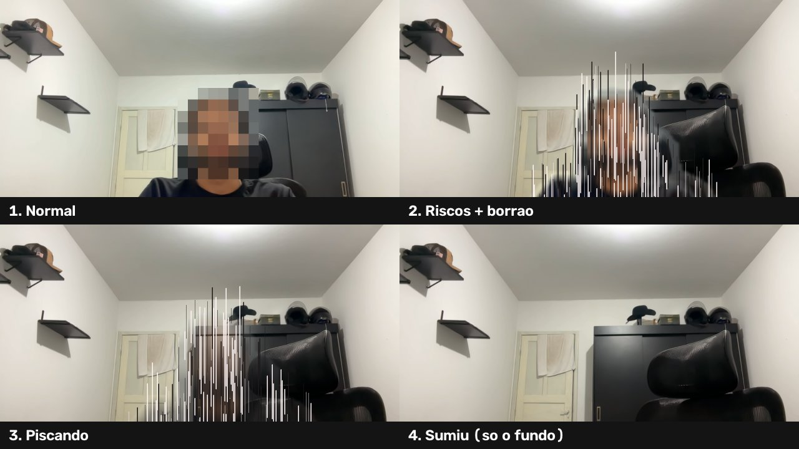
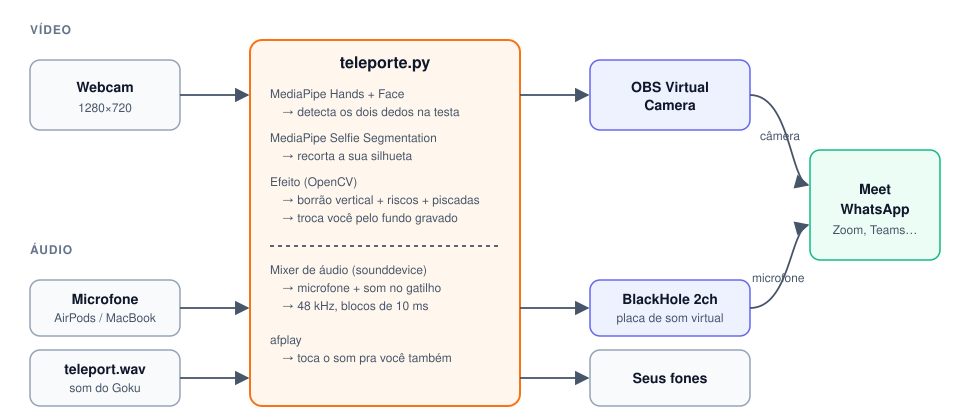

<p align="center">
  <picture>
    <source media="(prefers-color-scheme: dark)" srcset="docs/img/ilusio-logo-escuro.png">
    
  </picture>
</p>

<p align="center"><b>Efeitos mágicos para a sua câmera nas videochamadas, controlados por gestos.</b></p>

<p align="center">
  <a href="https://github.com/mvtiburcio/teleporte-instantaneo/releases/latest"></a>
  
  
  
  
  <a href="#apoie-o-projeto"></a>
</p>

O **Ilusio** coloca efeitos na sua webcam que funcionam no **Google Meet, Zoom, Teams e WhatsApp do Mac**: você faz um gesto e a mágica acontece na chamada, de verdade, para todo mundo ver.

O primeiro efeito é o **Teletransporte Instantâneo**, inspirado no Goku: coloque **dois dedos na testa**, ouça o *"vuush"* e **suma da câmera**, com os riscos verticais clássicos do anime. Faça o gesto de novo e você **reaparece**, de onde estiver.

<p align="center">
  
</p>

<p align="center">
  <a href="https://github.com/mvtiburcio/teleporte-instantaneo/releases/latest"></a>
</p>
<p align="center">Grátis · assinado e notarizado pela Apple · sem instalar mais nada<br>
Prefere o terminal? Veja <a href="#usar-pela-linha-de-comando">Usar pela linha de comando</a>.</p>

---

## Sumário

- [Como você quer usar?](#como-você-quer-usar)
- [Baixar e instalar o app](#baixar-e-instalar-o-app)
- [Usando o app](#usando-o-app)
- [Efeito: Teletransporte Instantâneo](#efeito-teletransporte-instantâneo)
- [Como funciona](#como-funciona)
- [Usar pela linha de comando](#usar-pela-linha-de-comando)
- [Solução de problemas](#solução-de-problemas)
- [Por dentro: problemas resolvidos](#por-dentro-problemas-resolvidos)
- [Apoie o projeto](#apoie-o-projeto)
- [Roadmap](#roadmap)
- [Contribuir](#contribuir)
- [Créditos e licença](#créditos-e-licença)

---

## Como você quer usar?

| | **App para Mac** (recomendado) | **Linha de comando** |
|---|---|---|
| Para quem | Qualquer pessoa | Quem programa, quer mexer no código ou tem macOS mais antigo |
| Como instala | [Baixa o `.dmg`](https://github.com/mvtiburcio/teleporte-instantaneo/releases/latest) e arrasta para Aplicativos | `git clone` + `./setup.sh` |
| Sistema | macOS 26+, Apple Silicon | macOS 13+ (Apple Silicon ou Intel) |
| Precisa instalar mais algo? | Não: câmera e microfone virtuais vêm dentro do app | Sim: Homebrew, Python 3.12, OBS e BlackHole (o `setup.sh` instala) |
| Câmera na chamada | **Ilusio Camera** | OBS Virtual Camera |
| Microfone na chamada | **Ilusio Mic** | BlackHole 2ch |
| Configuração | Tour + checklist guiado, tudo na tela | Configuração única do OBS |
| Atalhos | Globais (funcionam com a chamada em primeiro plano) | Teclas na janela de prévia |

## Baixar e instalar o app

**Requisitos:** Mac com Apple Silicon (M1 ou mais novo), macOS 26 ou mais novo e uma webcam (a do próprio Mac serve).

1. Baixe o **`Ilusio-<versão>.dmg`** na [última versão](https://github.com/mvtiburcio/teleporte-instantaneo/releases/latest).
2. Abra o `.dmg` e **arraste o Ilusio para a pasta Aplicativos**. Ele precisa estar lá: o macOS só ativa a câmera virtual de apps instalados em Aplicativos.
3. Abra o **Ilusio**. Um tour curto explica o app e termina no **checklist da Configuração**, que guia o resto em uns 5 minutos. Cada item fica verde sozinho:
   1. Permitir a câmera e o microfone (aviso padrão do macOS).
   2. **Ativar a Ilusio Camera**: o macOS pede para aprovar a extensão em *Ajustes do Sistema → Geral → Itens de Início e Extensões → Extensões de Câmera*.
   3. **Instalar o Ilusio Mic**: o macOS pede a sua senha de administrador, uma vez só.
   4. Gravar o fundo, testar o gesto e escolher **Ilusio Camera** e **Ilusio Mic** no app de chamada (o checklist mostra onde clicar no Meet, Zoom, Teams e WhatsApp).

O app é assinado com Developer ID e notarizado pela Apple, então abre sem aviso de "desenvolvedor não identificado". Para conferir o download: `shasum -a 256 -c Ilusio-<versão>.dmg.sha256`.

**Atualizar:** baixe a versão nova e substitua o Ilusio em Aplicativos.

**Desinstalar:** arraste o Ilusio de Aplicativos para o Lixo; o macOS remove a Ilusio Camera junto. O microfone sai com:

```bash
sudo rm -rf /Library/Audio/Plug-Ins/HAL/IlusioMic.driver && sudo killall coreaudiod
```

## Usando o app

Interface em SwiftUI com o visual Liquid Glass do macOS 26.

**Abas.**

| Aba | O que tem |
|---|---|
| **Início** | Prévia com status (ao vivo, fundo pronto, fps), seletor de câmera, Ligar, Gravar fundo e Some/Volta. A borda brilha em verde quando o gesto é reconhecido. |
| **Câmera e mic** | Escolha da câmera (a do Mac é o padrão; o iPhone por Continuidade só se você escolher) e do microfone, medidor de nível, teste de som, volume do efeito e sensibilidade do gesto. |
| **Configuração** | O checklist guiado. |
| **Atalhos** | Atalhos globais configuráveis. |
| **Apoiar** | Pix para apoiar o projeto. |
| **Ajustes** | Tema (Sistema, Claro, Escuro), rever o tour, registro do motor. |

**Atalhos globais** (padrões, configuráveis na aba Atalhos):

| Atalho | Ação |
|---|---|
| `⌃⌥T` | Sumir / voltar |
| `⌃⌥L` | Ligar / desligar o Ilusio |
| `⌃⌥B` | Gravar o fundo |
| `⌃⌥R` | Reaparecer na hora (sem efeito) |

## Efeito: Teletransporte Instantâneo

### O gesto

<p align="center">
  
</p>

- A posição da testa é calculada a partir dos **olhos**: o ponto médio entre eles, subindo 0,6× a distância entre os olhos.
- A tolerância é proporcional a essa distância, então o gesto funciona **perto ou longe** da câmera.
- Se a mão esconder parte do rosto, o motor usa a última posição vista por até 1 segundo.
- Segure ~0,25 s. Depois de disparar, **tire a mão** antes do próximo gesto; segurar não fica alternando.

### As etapas do efeito

<p align="center">
  
</p>

O efeito dura **0,9 s** e acompanha o som:

1. **Normal**: a câmera passa direto.
2. **Riscos e borrão**: a sua silhueta (MediaPipe Selfie Segmentation) é esticada na vertical e coberta por riscos brancos e pretos, como no anime.
3. **Piscando**: você fica cada vez mais transparente, piscando entre o fundo e a sua imagem.
4. **Sumiu**: a chamada recebe só a foto do fundo, até você fazer o gesto de novo.

**Grave o fundo** antes de usar. Saia do quadro **e da frente da luz**: se a sua sombra estiver na parede, ela entra na foto e fica lá quando você sumir.

## Como funciona

<p align="center">
  
</p>

1. **Vídeo.** O motor (`teleporte.py`) procura o gesto com o **MediaPipe** (mão + rosto). Quando ele dispara, o motor recorta a sua silhueta e aplica o efeito. O resultado sai por uma **câmera virtual**, que a chamada enxerga como uma câmera normal: no app, a **Ilusio Camera** (uma extensão de câmera do macOS, aprovada uma vez no checklist); na linha de comando, a OBS Virtual Camera.
2. **Áudio.** As chamadas **cortam** o que sai do alto-falante (cancelamento de eco), então tocar o som no Mac não basta. O motor vira o seu microfone: mistura o microfone de verdade com o som do efeito e manda tudo para um **microfone virtual**: no app, o **Ilusio Mic**, que vai dentro do app; na linha de comando, o BlackHole 2ch.
3. **Sumir.** Enquanto você está "teleportado", a chamada recebe a **foto do fundo** gravada antes, sem sombra nem contorno.
4. **No app.** O app captura a câmera escolhida e troca os frames com o motor por **memória compartilhada** (`ipc.py`). Os comandos e eventos vão em JSON por linha. A prévia, os atalhos e o checklist ficam no app; o efeito, no motor.

## Usar pela linha de comando

Para quem programa ou quer mexer no efeito. Funciona também em Macs Intel e no macOS 13+, usando o OBS e o BlackHole como câmera e microfone virtuais.

### Início rápido

```bash
git clone https://github.com/mvtiburcio/teleporte-instantaneo.git
cd teleporte-instantaneo
./setup.sh      # instala tudo (uma vez)
./teleporte     # roda
```

Na chamada, escolha a câmera **OBS Virtual Camera** e o microfone **BlackHole 2ch**. Na janela *teleporte*, **B** grava o fundo e **dois dedos na testa** fazem você sumir e voltar.

### Requisitos

| Item | Por quê |
|---|---|
| **macOS** (Apple Silicon ou Intel) | Câmera virtual do OBS e `afplay`/`afconvert` são do Mac |
| [**Homebrew**](https://brew.sh) | Instala o resto automaticamente |
| **Python 3.12** | O MediaPipe ainda não tem pacote para 3.13/3.14 (o `setup.sh` instala) |
| **OBS Studio** 30+ | Fornece a câmera virtual (o `setup.sh` instala) |
| **BlackHole 2ch** | Leva o som do efeito para a chamada (o `setup.sh` instala) |
| Webcam + microfone | Os do próprio Mac servem |

### Instalação

O `setup.sh` faz, nesta ordem:

1. Instala o **Python 3.12**, o **OBS** e o **BlackHole 2ch** via Homebrew. O BlackHole pede a sua senha de administrador.
2. Reinicia o serviço de áudio do Mac (`sudo killall coreaudiod`), para o BlackHole aparecer na lista de dispositivos. O som corta por ~2 segundos.
3. Cria o ambiente Python em `.venv/` e instala as dependências do `requirements.txt`.
4. Prepara o som: converte `sons/goku-teleport.mp3` em `sons/teleport.wav`, cortando o silêncio do começo.

> **Atalho opcional:** para rodar de qualquer pasta digitando só `teleporte`:
> ```bash
> echo "alias teleporte=\"$PWD/teleporte\"" >> ~/.zshrc && source ~/.zshrc
> ```

### Configuração única do OBS

Só precisa ser feita **uma vez**, para o macOS liberar a câmera virtual:

1. Abra o **OBS**. Se ele perguntar sobre fontes de vídeo vazias, clique em **Sim**: quem manda a imagem é o motor, o OBS não precisa de cena.
2. Clique em **Iniciar câmera virtual**.
3. O macOS avisa que a extensão foi bloqueada. Vá em **Ajustes do Sistema → Geral → Itens de Início e Extensões → Extensões de Câmera** (ⓘ), ative o **OBS Studio** e digite sua senha.
4. Volte ao OBS: o botão vira **Interromper câmera virtual**, sinal de que funcionou. Clique nele e **feche o OBS (⌘Q)**.

> O OBS precisa estar **fechado** enquanto o efeito roda: só um programa pode alimentar a câmera virtual por vez.

Na primeira execução, o macOS pede permissão de **Câmera** e **Microfone** para o Terminal. Se o pedido não aparecer, ative em **Ajustes do Sistema → Privacidade e Segurança → Câmera / Microfone → Terminal**.

### Configurar a chamada

**Google Meet** (`⋮ → Configurações`):

| Aba | Opção | Valor |
|---|---|---|
| Vídeo | Câmera | **OBS Virtual Camera** |
| Vídeo | Resolução de envio | **Alta definição (720p)** |
| Áudio | Microfone | **BlackHole 2ch** |
| Áudio | Cancelamento de ruído | **Desligado** (senão o Meet pode cortar o som) |
| `⋮ → Aplicar efeitos visuais` | — | **Sem efeito** (o desfoque do Meet borra a imagem quando você some) |

**WhatsApp (app do Mac)**: na chamada de vídeo, no menu de câmera e microfone, escolha **OBS Virtual Camera** e **BlackHole 2ch**. Se o app não deixar escolher o microfone, mude **Ajustes do Sistema → Som → Entrada** para **BlackHole 2ch** *antes* de rodar; o motor detecta isso e usa o primeiro microfone de verdade da lista. O WhatsApp do celular não funciona, porque a câmera é a do telefone.

**Zoom / Teams / outros**: mesmo esquema, com efeitos de fundo e supressão de ruído desligados.

### Teclas (janela *teleporte* em foco)

| Tecla | Ação |
|---|---|
| `B` | Grava o fundo (com contagem de 5 s) |
| `R` | Reaparece na hora, sem efeito |
| `Q` | Fecha |

Depois da chamada, aperte **Q** e volte o microfone da chamada para o normal: com o motor fechado, o BlackHole fica mudo.

### Ajustes finos

Todos no começo do `teleporte.py` (no app, volume e sensibilidade ficam na aba Câmera e mic):

| Constante | Padrão | O que faz |
|---|---|---|
| `REACH` | `1.5` | Tolerância dos dedos até a testa. **Suba** (ex.: `2.0`) se o gesto não for reconhecido. |
| `HOLD_S` | `0.25` | Quanto tempo segurar o gesto para disparar. |
| `FX_S` | `0.9` | Duração do efeito. Combine com a duração do seu som. |
| `SOUND_LEAD` | `0.1` | Atraso entre o disparo e o começo do efeito (o *pré-roll* do som). |
| `GROW_PX` | `31` | Quanto a máscara cresce além do seu contorno. **Suba** se sobrar borda. |
| `BG_DELAY_S` | `5` | Contagem entre apertar **B** e gravar o fundo. |
| `SFX_GAIN` | `0.8` | Volume do som na chamada, em relação ao microfone. |

### Trocar o som

Serve qualquer áudio que o macOS abre (mp3, m4a, wav, aiff…):

```bash
.venv/bin/python tools/preparar_som.py ~/Downloads/meu-som.mp3
```

O script converte para `sons/teleport.wav` e **corta o silêncio do começo**, deixando 0,1 s, que casa com `SOUND_LEAD`. Também corta o do fim. Ajuste `FX_S` para a duração da parte mais forte do som.

## Solução de problemas

| Sintoma | Causa | Solução |
|---|---|---|
| A chamada mostra **"Abra o Ilusio"** | A Ilusio Camera está escolhida, mas o Ilusio está desligado | Abra o Ilusio e clique em **Ligar o Ilusio** no Início. |
| A chamada mostra o **logo do OBS** com uma câmera riscada | Nada está alimentando a câmera virtual | Ligue o Ilusio (ou rode `./teleporte`). Se já estiver ligado, troque de câmera na chamada e volte. |
| `Câmera virtual indisponível` | O OBS está aberto usando a câmera virtual | Feche o OBS (⌘Q) e tente de novo. |
| `Webcam não encontrada` / `not authorized to capture video` | Sem permissão de câmera | Ajustes do Sistema → Privacidade e Segurança → Câmera → ative o Ilusio (ou o Terminal). |
| Fica uma **sombra** quando você some | A sua sombra estava na parede quando o fundo foi gravado | Grave o fundo de novo, saindo também da frente da luz. |
| Sobra um **contorno** em volta de você no efeito | Máscara apertada | Suba `GROW_PX` (41, 51…). |
| O gesto **não é reconhecido** | Tolerância baixa, mão longe ou rosto escondido | Aumente a sensibilidade (ou `REACH`) e deixe os olhos visíveis. |
| Imagem **borrada** na chamada | Desfoque de fundo da própria chamada | Desligue os efeitos visuais do Meet/Zoom/Teams. |
| A chamada **não ouve** o som | Microfone errado ou supressão de ruído | Microfone **Ilusio Mic** (app) ou **BlackHole 2ch** (linha de comando); desligue o cancelamento de ruído. |
| O **Ilusio Mic** (ou o BlackHole) não aparece depois de instalar | O CoreAudio não recarregou | `sudo killall coreaudiod` ou reinicie o Mac. |
| `PaMacCore ... err='-50'` no Terminal | Aviso do driver ao abrir o BlackHole | Pode ignorar: o áudio passa certo (o `./teleporte` já esconde esse aviso). |
| O app mostra "O motor parou" | Erro no motor | Ajustes → Registro do motor → **Mostrar no Finder** e abra o `engine.log`. |

## Por dentro: problemas resolvidos

Coisas não óbvias que apareceram no caminho e já estão tratadas no código:

- **A câmera virtual "rouba" o índice 0.** Na linha de comando, a OBS Virtual Camera entra na lista do OpenCV e a webcam muda de índice. O `open_webcam()` manda magenta para a câmera virtual e fica com a primeira câmera que devolve **outra** coisa. O app escapa disso capturando a câmera pelo identificador do AVFoundation.
- **Microfone e BlackHole num fluxo só devolvem lixo (`NaN`).** São dois dispositivos com relógios diferentes. A solução foram dois fluxos ligados por uma fila curta, que descarta blocos antigos para o atraso não crescer.
- **BlackHole a 48 kHz.** Com outra taxa, o CoreAudio reclama; o som é reamostrado para 48 kHz ao carregar.
- **Desempenho.** Mão e rosto custam ~25 ms por frame no M2, então a detecção roda a cada 2 frames para manter 30 fps. A segmentação da silhueta só roda durante o efeito.
- **Sumir = imagem inteira do fundo.** Trocar só a área da pessoa deixava sombra e diferença de exposição.
- **Frames entre o app e o motor sem rasgo.** A memória compartilhada usa *seqlock*: o contador fica ímpar enquanto alguém escreve, e quem lê descarta o frame se o contador mudou no meio.
- **Python do Homebrew fora do venv.** Com `..` no caminho, `standardizedFileURL` resolve symlinks e transforma o `.venv/bin/python` no Python do sistema, sem numpy. O app padroniza só a pasta.

## Apoie o projeto

O Ilusio é **grátis e de código aberto**. Se ele te fez rir numa reunião, um Pix de **qualquer valor** ajuda a manter o projeto e a criar novos efeitos.

<p align="center">
  
</p>

Abra o app do seu banco, escolha **Pix → Ler QR code** ou **Pix copia e cola** e digite o valor que quiser:

```
00020126580014br.gov.bcb.pix0136d1fef5be-4e51-4a50-86fb-8810cb8bfcd45204000053039865802BR5906ILUSIO6006RECIFE62070503***63048C40
```

O mesmo Pix está na aba **Apoiar** do app. Também ajuda muito dar uma ⭐ no repositório, abrir issues com ideias de efeitos e mandar PRs.

## Roadmap

- [x] Efeito Teletransporte Instantâneo
- [x] App para Mac: Início, Câmera e mic, Configuração guiada, Atalhos globais, Apoiar, Ajustes e tour de primeiro acesso
- [x] Câmera virtual própria (**Ilusio Camera**), sem precisar do OBS
- [x] Microfone virtual próprio (**Ilusio Mic**), sem precisar instalar o BlackHole
- [x] `.dmg` assinado com Developer ID e notarizado, publicado nas [Releases](https://github.com/mvtiburcio/teleporte-instantaneo/releases/latest)
- [ ] Novos efeitos com gestos. Tem uma ideia? [Abra uma issue](https://github.com/mvtiburcio/teleporte-instantaneo/issues).

## Contribuir

```
teleporte-instantaneo/
├── teleporte.py           # motor: gesto, efeito, câmera virtual e mixer de áudio (--ipc = modo app)
├── ipc.py                 # ponte com o app: frames em memória compartilhada + comandos JSON
├── app/                   # app Ilusio em SwiftUI (gere o projeto com xcodegen)
├── tests/                 # testes do motor
├── teleporte              # lançador da linha de comando (esconde os logs internos do MediaPipe/CoreAudio)
├── setup.sh               # instala tudo
├── requirements.txt       # dependências Python fixadas
├── sons/goku-teleport.mp3 # som original (o teleport.wav é gerado a partir dele)
├── tools/                 # preparar_som.py, gerar_demo.py e congelar_motor.sh (motor dentro do app)
└── docs/                  # imagens do README, spec e planos de cada PR
```

Testes:

```bash
.venv/bin/python -m unittest discover -s tests          # motor
cd app && xcodebuild test -project Ilusio.xcodeproj -scheme Ilusio -destination 'platform=macOS,arch=arm64'
```

Para rodar o **app a partir do código** (macOS 26+, Xcode e `brew install xcodegen`), usando o motor em Python do `.venv`:

```bash
./setup.sh
cd app && xcodegen generate && open Ilusio.xcodeproj
```

Opcional: crie `app/Local.xcconfig` (fora do git) com `CODE_SIGN_IDENTITY` e `DEVELOPMENT_TEAM` da sua conta Apple. Assim o macOS lembra a permissão de câmera entre builds.

Para gerar o app completo (Release), que leva o motor congelado e não precisa de Python:

```bash
.venv/bin/pip install -r requirements-dev.txt   # PyInstaller
tools/congelar_motor.sh                          # build/engine/dist/ilusio-engine (~250 MB)
ILUSIO_ENGINE=$PWD/build/engine/dist/ilusio-engine/ilusio-engine .venv/bin/python -m unittest tests.test_engine_smoke
cd app && xcodebuild -project Ilusio.xcodeproj -scheme Ilusio -configuration Release build
```

Para gerar o `.dmg` de release (Developer ID da TKI, notarizado e grampeado; a release no GitHub sai como **rascunho**):

```bash
scripts/release.sh 0.1.0                  # tudo, com rascunho no GitHub
scripts/release.sh 0.1.0 --sem-publicar   # só o .dmg notarizado
```

O desenho do app está em `docs/superpowers/specs/2026-10-24-app-macos-design.md`. Cada PR tem o seu plano em `docs/superpowers/plans/`.

## Créditos e licença

- Código sob a [licença MIT](LICENSE). O **nome Ilusio e o logotipo não estão cobertos pela MIT**: forks devem usar outro nome e logo. Detalhes em [NOTICE.md](NOTICE.md).
- O **Ilusio Mic** é o driver do [BlackHole](https://github.com/ExistentialAudio/BlackHole) (v0.7.2, © Existential Audio Inc.) compilado com outro nome por `app/IlusioMic/build.sh`. Ele é distribuído sob a **GPL-3.0**, com a licença dentro do driver, e o código-fonte está no link. Para remover: `sudo rm -rf /Library/Audio/Plug-Ins/HAL/IlusioMic.driver && sudo killall coreaudiod`.
- Feito com [MediaPipe](https://github.com/google-ai-edge/mediapipe), [OpenCV](https://opencv.org), [pyvirtualcam](https://github.com/letmaik/pyvirtualcam), [python-sounddevice](https://github.com/spatialaudio/python-sounddevice), [OBS Studio](https://obsproject.com) e [BlackHole](https://github.com/ExistentialAudio/BlackHole).
- *Dragon Ball* e o efeito sonoro do Teletransporte Instantâneo pertencem aos seus detentores (Akira Toriyama / Toei Animation). Este é um projeto de fã, gratuito e sem afiliação; as doações são apoio voluntário. O áudio **não** está coberto pela licença MIT. Se você é detentor dos direitos e quer a remoção, abra uma issue.
